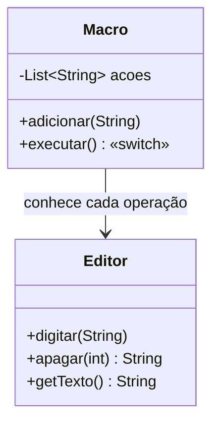
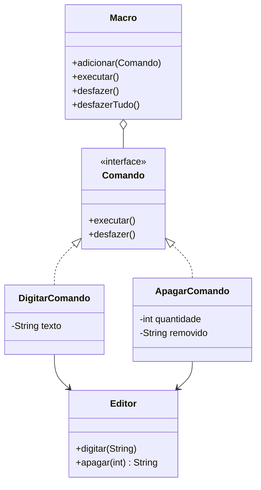

# Atividade 17 — Command

Código original em [`antes/`](antes) e refatorado em [`depois/`](depois). Rodar: `mvn compile && java -cp target/classes br.venson.net.designpatterns.command.Main` (Java 17).

## Exercício 1 — Aplicações

1. **Barra de ferramentas com desfazer/refazer — faz sentido.** Cada botão dispara um objeto `Comando` com `executar()`/`desfazer()`; a barra não conhece os detalhes das operações.
2. **Agendador de tarefas — faz sentido.** Como o pedido é um objeto, pode ser enfileirado, executado depois e cancelado antes de rodar.
3. **Sistema de macros — faz sentido.** A macro grava uma lista de comandos e a repete (ou desfaz) como um único comando composto.
4. **`Relatorio` sempre igual — não faz sentido.** Fluxo fixo, sem fila, parâmetros ou undo; um método direto resolve.
5. **`Ponto` que só soma — não faz sentido.** Sem necessidade de reverter, enfileirar ou parametrizar a operação, encapsulá-la em objeto é complexidade gratuita.

## Exercício 2 — Anti-pattern

1. **`switch` na `Macro`.** Ela conhece cada operação, sua sintaxe e chama o `Editor` diretamente. Incluir `SUBSTITUIR` obriga a editar o `switch` (violando o aberto/fechado) e a `Macro` passa a depender de mais um método do `Editor`.
2. **Strings.** Sem tipo nem validação em compilação: `"APAGAR:abc"` estoura `NumberFormatException` em runtime, `"DIGITAR"` sem parâmetro estoura `ArrayIndexOutOfBounds`, e texto contendo `:` é quebrado errado pelo `split`.
3. **Sem desfazer.** A macro não guarda estado anterior. Para reverter, `DIGITAR` precisa lembrar o que digitou e `APAGAR` precisa guardar o texto removido — informação que só o próprio comando tem.
4. **Refatoração.**
   - `Comando`: interface com `executar()` e `desfazer()`.
   - `DigitarComando` / `ApagarComando`: comandos concretos, com seus parâmetros e o estado necessário para desfazer.
   - `Editor` (receiver): executa o trabalho real; não mudou.
   - `Macro` (invoker): armazena `Comando`s, executa na ordem e desfaz em ordem inversa.
5. **Benefícios.** Uma nova ação é só uma nova classe `Comando`, sem tocar na `Macro`. Como o comando é um objeto, o mesmo pode ser enfileirado, agendado, registrado em log e desfeito.

## Diagramas de classes

**Antes**

**Depois**

## Decisões de design

- **Interface `Comando`:** é o único contrato conhecido pela `Macro`, o que remove o `switch` e permite adicionar ações sem alterá-la (aberto/fechado).
- **Estado de undo dentro do comando:** `ApagarComando` guarda o texto removido ao executar, porque só ele sabe o que precisa para reverter; `DigitarComando` reverte apagando o tamanho do texto digitado.
- **`Editor` inalterado como receiver:** a lógica de negócio fica onde estava; os comandos apenas a invocam.
- **`Macro` com pilha de executados:** `desfazer()` reverte em ordem inversa (LIFO), a ordem correta para desfazer uma sequência. A `Macro` deixa de receber o `Editor` no construtor, ficando desacoplada dele.
