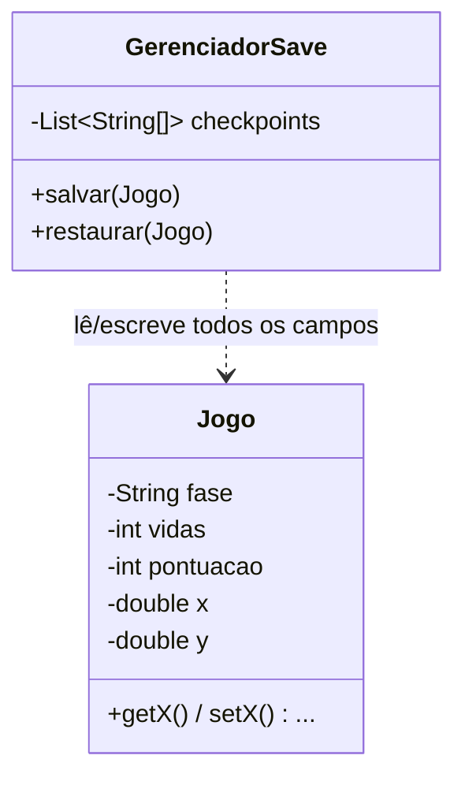
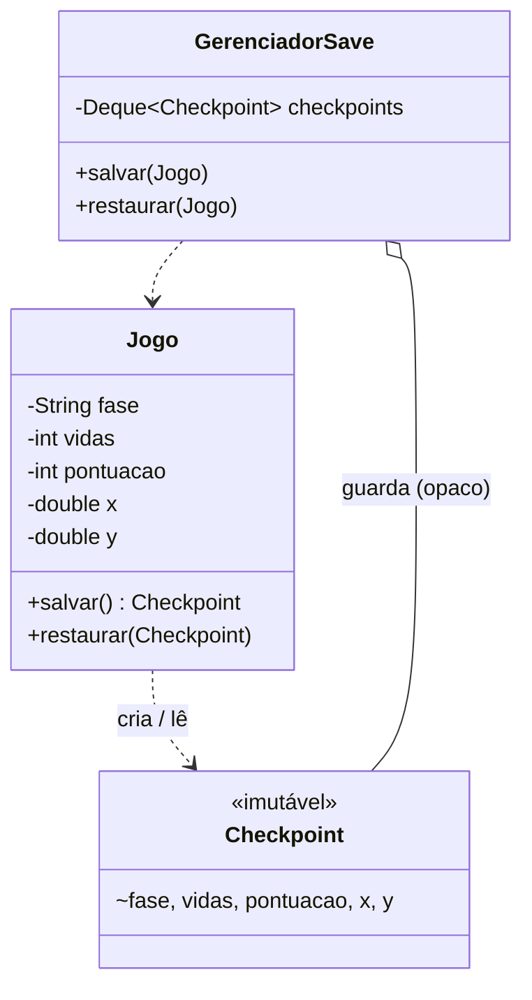

# Atividade 16 — Memento

Código original em [`antes/`](antes) e refatorado em [`depois/`](depois). Rodar: `mvn compile && java -cp target/classes br.venson.net.designpatterns.memento.Main` (Java 17).

## Parte 1 — Aplicações

1. **Checkpoints de jogo — faz sentido.** O sistema de save precisa guardar e restaurar o estado sem conhecer os atributos internos; é o caso clássico do Memento, com o jogo como originator.
2. **Desfazer/refazer em editor — faz sentido.** Cada edição gera um snapshot empilhado pelo caretaker, que volta no tempo sem acessar o conteúdo do editor.
3. **Wizard com voltar — faz sentido.** Cada etapa guarda um memento do formulário; "voltar" restaura o anterior sem expor os campos internos.
4. **`Configuracao` lida uma vez — não faz sentido.** Não há histórico nem restauração; o padrão só adicionaria classes sem necessidade.
5. **`Ponto` com `x` e `y` — não faz sentido.** O estado é trivial e público; copiar dois valores não justifica um memento.

## Parte 2 — Anti-pattern

1. **Encapsulamento.** Getters/setters para tudo deixam qualquer classe alterar o `Jogo` sem passar por regras, podendo gerar estados inconsistentes (ex.: vidas negativas, fase sem posição coerente).
2. **Acoplamento.** Ao adicionar um atributo (ex.: `inimigos`) mudam 4 pontos: o campo no `Jogo`, getter/setter, o `salvar` e o `restaurar` do gerenciador (e a ordem do `String[]`). O caretaker conhece cada campo: acoplamento forte.
3. **`String[]`.** Perde-se tipo e validação; a ordem é um contrato implícito, a conversão pode falhar em runtime (`NumberFormatException`) e o histórico é ilegível.
4. **Refatoração.**
   - `Checkpoint` (memento): imutável, campos `final` e visíveis só no pacote.
   - `Jogo` (originator): `salvar()` cria o `Checkpoint`; `restaurar(Checkpoint)` aplica o estado.
   - `GerenciadorSave` (caretaker): guarda `Checkpoint`s numa pilha, sem inspecioná-los.
   - Interface **estreita** (caretaker): `Checkpoint` é um tipo opaco, sem métodos públicos. Interface **ampla** (originator): acesso aos campos, restrito ao pacote.
5. **Evolução.** Um novo atributo muda apenas `Jogo` e `Checkpoint`; o `GerenciadorSave` permanece igual. O histórico é `Deque<Checkpoint>`, tipado e seguro.

## Diagramas de classes

**Antes**

**Depois**

## Decisões de design

- **`Checkpoint` imutável com campos package-private:** garante que o snapshot não muda depois de criado e que só o originator o lê, preservando o encapsulamento sem getters públicos.
- **Remoção de getters/setters do `Jogo`:** o estado só muda por operações do domínio (`jogar`) ou por `restaurar`, evitando alterações externas inconsistentes.
- **`GerenciadorSave` com `Deque<Checkpoint>`:** é um caretaker puro. Pilha porque restaurar volta sempre ao último checkpoint, e o tipo forte elimina conversões.
- **`Jogo` cria o próprio memento:** só quem conhece o estado sabe como capturá-lo; adicionar campos não afeta o caretaker.
